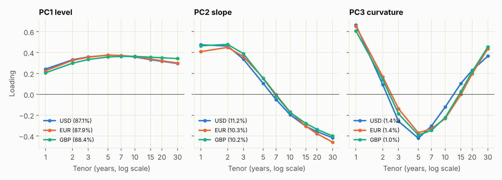
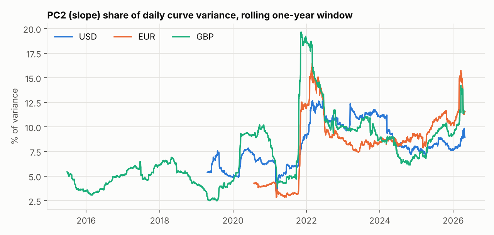
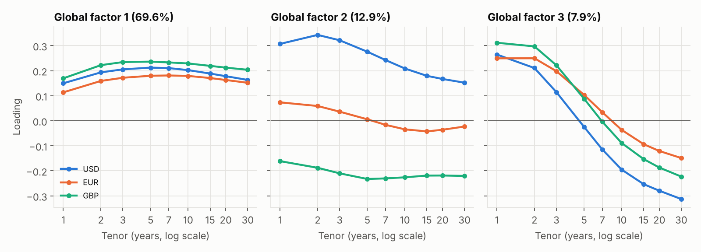
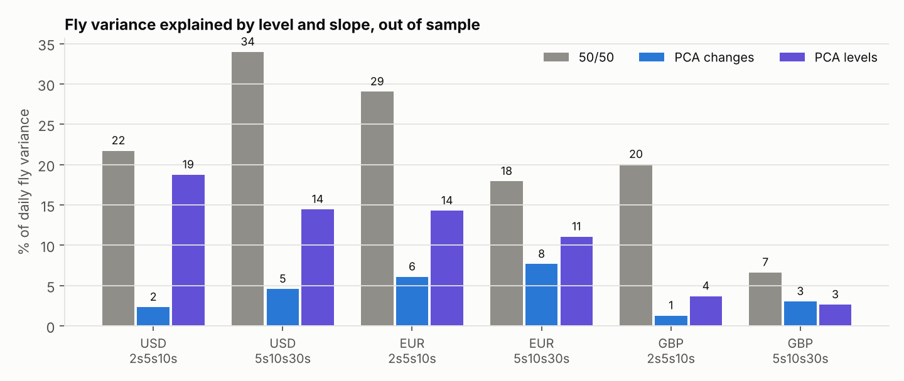
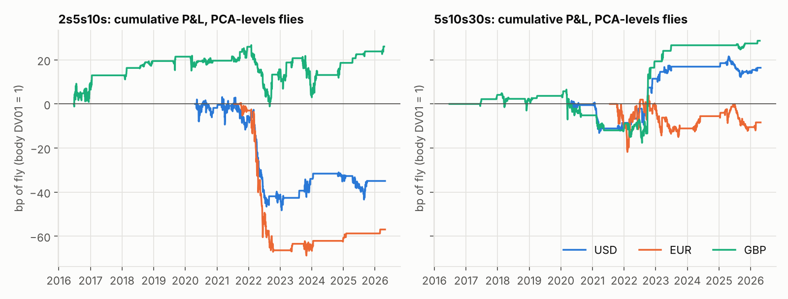
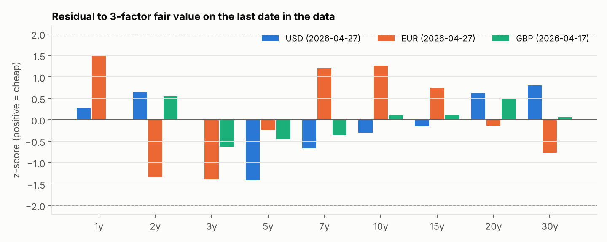

# PCA of USD, EUR and GBP OIS Swap Curves

Principal component analysis of USD SOFR, EUR €STR and GBP SONIA par swap curves, covering maturities from 1y to 30y using daily data through April 2026.

This project looks at how swap curves move, how closely rate movements are linked across currencies, and whether PCA can improve butterfly hedging and identify relative-value opportunities.

The methodology draws on practitioner research from [Salomon Smith Barney](https://github.com/yieldcurvemonkey/Curvy-CUSIPs/tree/main/research/PCA), Credit Suisse and Standard Chartered, particularly their work on curve risk, PCA hedging and swap relative value.

## Key findings

- **Three factors explain 99.5% to 99.7% of daily curve movements.** Level accounts for 87% to 88% of variance, slope for 10% to 11%, and curvature for around 1% to 1.4%. The factor shapes are remarkably similar across all three currencies.
- **A common global factor explains 69.6% of weekly movements across all 27 rates.** A second factor captures the divergence between USD and GBP, while EUR requires an additional factor to explain its own level movements.
- **Market timing matters for cross-currency analysis.** USD 10y moves correlate more strongly with the following day's EUR and GBP moves than with their same-day changes. Weekly data help account for differences in market closing times.
- **PCA weights estimated from daily changes produce better-hedged butterflies.** Across six flies, these weights reduce the share of variance explained by level and slope to 1% to 8%, compared with 7% to 34% using conventional 50/50 weights.
- **The classic PCA butterfly mean-reversion strategy struggles to make money.** The level-based strategy wins 70% of trades but loses 0.24bp per trade on average. Trades that fail to revert, particularly those entered during 2022, account for much of the underperformance.

## Data

The analysis uses daily Bloomberg par swap rates across three curves.

| Curve | Start date | End date | Observations |
|---|---|---|---:|
| USD SOFR | 17 Apr 2018 | 27 Apr 2026 | 2,007 |
| EUR €STR | 1 Aug 2019 | 27 Apr 2026 | 1,725 |
| GBP SONIA | 26 Jun 2014 | 17 Apr 2026 | 2,985 |

The original datasets contain 29 tenors, ranging from one week to 50 years. The analysis focuses on nine maturities:

`1y, 2y, 3y, 5y, 7y, 10y, 15y, 20y, 30y`

Data checks cover missing observations, stale rows and unusually large daily moves. The largest changes coincide with identifiable market events, including the March 2023 banking stress and the September 2022 UK gilt sell-off.

The GBP curve is also cross-checked against the Bank of England's OIS spot curve, using fitted zero-coupon rates across 2,599 common dates. GBP par rates average 0.5bp to 2.4bp above the BoE curve at the selected maturities, while daily changes have correlations of 0.92 to 0.95.

The original data are supplied as pickled pandas DataFrames. The loading script uses a restricted unpickler that permits only the required pandas and NumPy classes.

## 1. PCA of individual curves



The three curves share a similar factor structure. Level dominates daily movements, slope captures changes in the relationship between shorter and longer maturities, and curvature captures movements in the belly relative to the wings.

| Currency | Level | Slope | Curvature | Top 3 factors |
|---|---:|---:|---:|---:|
| USD | 87.1% | 11.2% | 1.4% | 99.7% |
| EUR | 87.9% | 10.3% | 1.4% | 99.5% |
| GBP | 88.4% | 10.2% | 1.0% | 99.6% |

The level factor peaks around 5y in USD and EUR, with loadings of 0.38, before declining to 0.30 at 30y. GBP behaves differently: its loadings remain between 0.34 and 0.36 from 5y to 30y, indicating that its long end moves more closely with the rest of the curve.

The slope factor pivots near 7y across all three currencies. Curvature broadly reflects the 1y and 30y maturities moving against the 5y belly.

## 2. Rolling slope variance



The share of variance explained by the second principal component rises sharply around the 2021 to 2022 tightening cycle.

| Currency | Median PC2 share | Peak PC2 share | Peak window ending |
|---|---:|---:|---|
| GBP | 6.5% | 19.7% | 9 Nov 2021 |
| EUR | 8.6% | 16.5% | 28 Feb 2022 |
| USD | 8.0% | 12.7% | 3 Mar 2022 |

GBP peaked first, in November 2021, followed by EUR and USD at the end of February and beginning of March 2022.

The latest rolling windows in April 2026 also show slope contributing more than its historical median in all three currencies.

| Currency | April 2026 PC2 share |
|---|---:|
| USD | 9.0% |
| EUR | 11.5% |
| GBP | 11.4% |

This is consistent with changing interest rate expectations making the relationship between the front end and the long end more important during the tightening cycle. The result is descriptive and does not establish causation.

## 3. Global PCA across currencies



To study cross-currency movements, the nine selected maturities from each curve are combined into a single 27-rate dataset.

The analysis uses Wednesday-to-Wednesday changes from 1 August 2019 to 17 April 2026, giving 350 weekly observations. Weekly sampling helps reduce the impact of differences in market closing times.

| Factor | Variance explained | Interpretation |
|---|---:|---|
| G1 | 69.6% | Broad moves in the same direction across all three curves |
| G2 | 12.9% | USD moving against GBP, with relatively little EUR exposure |
| G3 | 7.9% | Global slope movement, with front ends rising against longer maturities |
| G4 | 5.2% | EUR level movements relative to USD and GBP |

The first factor has positive loadings across all three currencies, with the largest in GBP and the smallest in EUR.

The second factor captures a divergence between USD and GBP. For example, the USD 2y loading is +0.34, while the GBP 10y loading is -0.23.

The fourth factor captures a distinct EUR level component, consistent with the ECB following a different policy path from the Federal Reserve and the Bank of England.

### Variance explained by global factors

| Currency | First factor | First 2 | First 3 | First 4 |
|---|---:|---:|---:|---:|
| USD | 63.8% | 84.6% | 93.9% | 95.3% |
| EUR | 70.9% | 71.7% | 79.1% | 94.9% |
| GBP | 74.0% | 87.0% | 93.9% | 96.1% |

Two global factors explain 84.6% of USD variance and 87.0% of GBP variance, but only 71.7% of EUR variance. Adding the fourth factor increases the EUR figure to 94.9%.

### Cross-currency correlations

| 10y rate pair | Daily correlation | Weekly correlation |
|---|---:|---:|
| USD-EUR | 0.65 | 0.73 |
| USD-GBP | 0.63 | 0.67 |
| EUR-GBP | 0.78 | 0.81 |

Daily correlations appear to understate some of the underlying relationships. USD 10y changes have a 0.14 correlation with the following day's EUR changes and 0.15 with the following day's GBP changes. The reverse correlation between EUR today and USD tomorrow is only 0.01.

This asymmetry is consistent with US rates reflecting market developments later in the day than European rates. It is one reason weekly data are more suitable for the cross-currency PCA.

## 4. PCA weights for butterfly hedging



Butterflies express views on the shape of the curve around a central maturity. A key challenge is separating curvature exposure from broader movements in the overall level and slope of rates.

Three weighting methods are compared:

- **50/50:** the body rate minus half of each wing.
- **PCA changes:** weights based on the third principal component of historical yield changes.
- **PCA levels:** weights based on the third principal component of historical yield levels.

At each month end, weights are estimated using the previous two years of data and held fixed throughout the following month. Hedge quality is measured using the out-of-sample R-squared from regressing daily fly changes against the average curve move and the 2s30s change.

Lower R-squared values indicate less exposure to these two broad factors.

| Butterfly | 50/50 | PCA changes | PCA levels |
|---|---:|---:|---:|
| USD 2s5s10s | 21.7% | 2.3% | 18.7% |
| USD 5s10s30s | 34.0% | 4.6% | 14.4% |
| EUR 2s5s10s | 29.0% | 6.1% | 14.3% |
| EUR 5s10s30s | 17.9% | 7.7% | 11.1% |
| GBP 2s5s10s | 20.0% | 1.3% | 3.7% |
| GBP 5s10s30s | 6.6% | 3.0% | 2.6% |

PCA weights estimated from changes give the lowest R-squared in five of the six butterflies. In the remaining case, GBP 5s10s30s, they are within 0.4 percentage points of the best result.

The difference is particularly clear in USD 5s10s30s, where the R-squared falls from 34.0% with 50/50 weights to 4.6% with PCA change-based weights.

All six conventional 50/50 butterflies retain some exposure to the overall level of rates, with a 1bp level move corresponding to a 0.02bp to 0.10bp change in the fly.

The results support using change-based PCA weights when the objective is to isolate a relative-value view on curve shape. Better hedging does not, by itself, guarantee better trading returns.

## 5. Backtesting the Salomon butterfly strategy



The backtest follows the PCA mean-reversion approach described in Salomon Smith Barney's research.

Weights are estimated from yield levels over the previous two years. A trade is entered when the fly moves beyond its 97th or 3rd percentile over that window, taking the opposite position on the relative richness of the body. The position is closed when the fly returns inside the 90th or 10th percentile, or after 60 trading days.

Weights and reference percentiles remain fixed throughout each trade. No data after the entry date are used. P&L is measured in basis points of fly with the body DV01 set to 1, before transaction costs.

### Results by butterfly

| Butterfly | Trades | Hit rate | Average P&L (bp) | Total P&L (bp) | Worst trade (bp) | Timed out | Sharpe |
|---|---:|---:|---:|---:|---:|---:|---:|
| USD 2s5s10s | 18 | 50% | -1.94 | -34.9 | -27.1 | 10 | -0.46 |
| USD 5s10s30s | 19 | 79% | +0.86 | +16.4 | -10.6 | 5 | 0.38 |
| EUR 2s5s10s | 10 | 50% | -5.69 | -56.9 | -33.5 | 5 | -0.96 |
| EUR 5s10s30s | 19 | 68% | -0.44 | -8.4 | -12.5 | 7 | -0.14 |
| GBP 2s5s10s | 31 | 81% | +0.84 | +26.1 | -10.9 | 8 | 0.28 |
| GBP 5s10s30s | 22 | 73% | +1.30 | +28.7 | -8.6 | 8 | 0.33 |

The GBP butterflies perform positively over the sample, while the USD and EUR 2s5s10s trades are particularly weak.

### Pooled results across all six butterflies

| Weighting method | Trades | Hit rate | Average P&L (bp) | Average if reverted (bp) | Average if timed out (bp) | Timed out |
|---|---:|---:|---:|---:|---:|---:|
| PCA levels | 119 | 70% | -0.24 | +2.86 | -5.73 | 36% |
| PCA changes | 112 | 65% | -0.52 | +2.78 | -5.64 | 39% |
| 50/50 | 112 | 80% | +1.13 | +2.63 | -3.14 | 26% |

The level-based PCA strategy wins 70% of its trades but loses 0.24bp per trade on average. Trades that revert earn around 2.86bp, while those that time out lose 5.73bp. Around 36% of trades fail to revert within the holding period.

### The impact of 2022

The losses are concentrated in trades entered during 2022. The 31 PCA-level trades opened that year averaged -2.13bp. USD and EUR 2s5s10s trades lost 38.9bp and 63.4bp respectively, more than their full-sample losses.

These were pay-body trades. As rate hike expectations changed, the 5y maturity continued to richen relative to the wings, extending the move against the positions.

Outside 2022, the average PCA-level trade made +0.42bp. This suggests the strategy's results are sensitive to the market regime and that historical extremes can persist when the curve is undergoing a sustained repricing.

The 50/50 strategy produces a better average result of +1.13bp per trade, but the hedge analysis shows that conventional flies retain more exposure to level and slope. Some of this performance may therefore reflect directional risk rather than pure relative value.

Alternative entry and exit percentile combinations, with 60-day and 120-day holding limits, do not materially change the overall conclusion. Across the six flies, the median Sharpe ranges from -0.40 to 0.07, and no configuration produces positive results across more than three flies.

The results highlight a weakness of simple mean-reversion rules: frequent small wins can be outweighed by a smaller number of persistent adverse moves.

## 6. Curve residuals and relative value



The final analysis examines individual tenors relative to the curve implied by the first three principal components.

For each day, three principal components are fitted to the previous year's yield levels. The residual is calculated as the observed rate minus its three-factor fitted value, then standardised using its own trailing one-year distribution.

This provides a simple way to identify maturities that have moved unusually far from the broader curve structure, following the residual-based approaches discussed by Credit Suisse and Standard Chartered.

Key results:

- Residual standard deviations range from 0.4bp to 1.9bp.
- Estimated half-lives range from 6 to 26 trading days.
- At the end of the sample in April 2026, no tenor is more than 1.5 standard deviations from its fitted value.
- The largest residuals are EUR 1y at +1.49 standard deviations and USD 5y at -1.41.
- At least one tenor exceeds two standard deviations on 26% to 32% of days.

A two-sigma residual is therefore relatively common in this dataset and should not automatically be treated as a trading signal. These readings describe the curve as of April 2026 and do not indicate current market conditions.

## Limitations

- **Data provenance:** The curves are described as Bloomberg data, but the repository does not yet document their provenance in sufficient detail.
- **Early observations:** SOFR swaps were relatively illiquid in 2018, while €STR was first published in October 2019. The earliest USD and EUR observations may include proxy data or reflect less liquid markets.
- **Transaction costs:** Butterfly P&L excludes bid-offer costs across all three legs on entry and exit.
- **Small sample:** Each butterfly has only 10 to 31 trades, limiting the conclusions that can be drawn from the reported Sharpe ratios.
- **Regime dependence:** The 2022 losses show that mean-reversion assumptions can break down during sustained repricing.
- **Parameter selection:** The alternative entry, exit and holding-period configurations are reported in full, although the parameter search is not exhaustive.

The results are best treated as an investigation of curve structure, hedging and historical strategy behaviour rather than evidence of a ready-to-trade strategy.

## Reproducing the analysis

Install the required dependencies:

```bash
pip install -r requirements.txt
```

Convert the original curve files into CSV data:

```bash
python src/load_data.py \
    usd_sofr_curve.p \
    eur_estr_curve.p \
    gbp_sonia_curve.p
```

Run the main PCA analysis:

```bash
python src/swaps_pca.py
```

Optionally validate the GBP curve against the Bank of England data:

```bash
python src/validate_gbp.py
```

The main script generates the charts, trade list and `output/results.json`. Validation results are stored in `output/validation.json`, while individual backtest trades are recorded in `output/salomon_trades.csv`.

### Repository outputs

| File | Contents |
|---|---|
| `output/fig1_loadings_by_ccy.png` | PCA loadings by currency |
| `output/fig2_rolling_slope_share.png` | Rolling slope variance share |
| `output/fig3_global_factors.png` | Global PCA factors |
| `output/fig4_hedge_test.png` | Out-of-sample butterfly hedge comparison |
| `output/fig5_salomon_backtest.png` | Butterfly backtest results |
| `output/fig6_residual_zscores.png` | Curve residual z-scores |
| `output/results.json` | Main numerical results |
| `output/validation.json` | Bank of England validation results |
| `output/salomon_trades.csv` | Individual backtest trades |

## References

1. Baygun, Showers and Cherpelis, *Principles of Principal Components: A Fresh Look at Risk, Hedging, and Relative Value*, Salomon Smith Barney, January 2000.
2. Pelata, Giannopoulos and Haworth, *PCA Unleashed*, Credit Suisse Fixed Income Research, October 2012.
3. Lee, Davies and Fernandez, *Introducing a Relative-Value Tool for Swaps*, Standard Chartered Rates Alert, August 2013.

The papers are collected in the [Curvy-CUSIPs PCA research directory](https://github.com/yieldcurvemonkey/Curvy-CUSIPs/tree/main/research/PCA).
